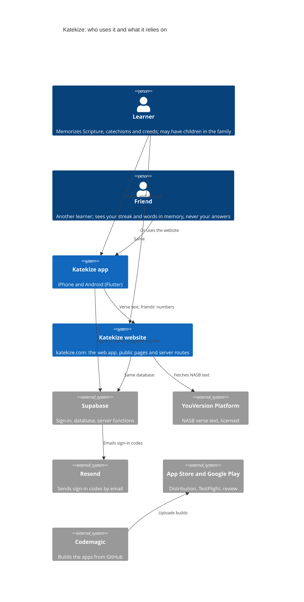
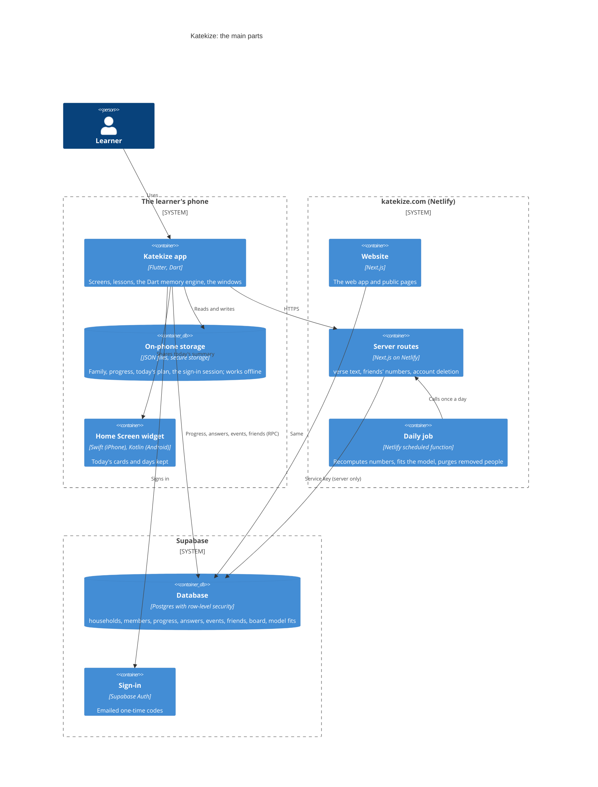
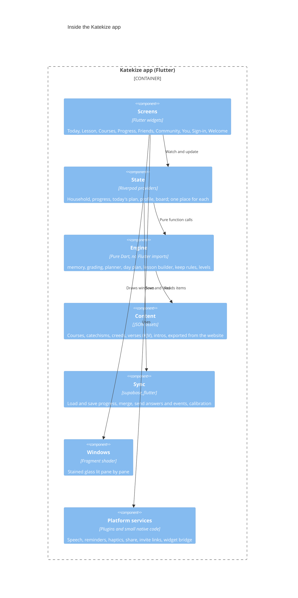

# Katekize for iPhone and Android: the plan

**Who this is for.** Landon (the owner, not a programmer) and the AI that writes the code. Each section says what it is
for. Plain words first; the technical detail the AI needs is in clearly marked places and in the linked decision records
(ADRs).

**Status.** Plan, 2026-11-25. Nothing in `app/` is built yet.

---

## 1. What we are building, in one paragraph

A real phone app, for iPhone and Android, built with **Flutter**. It looks and works like the Katekize website does today:
- Today's cards;
- the lessons;
- the stained-glass windows;
- courses, progress, friends and the community board.

It uses the **same accounts and the same data** as the website, so anyone can use both and their progress follows them.
The website keeps running. The app adds things a website can't do well:
- answers spoken out loud (native speech);
- daily reminders;
- a small Home Screen widget;
- invite links that open the app.

## 2. What stays the same, what is new

| Stays the same | New for the app |
|---|---|
| **Supabase:** the database, sign-in by emailed code, every table and server function | The app itself, in a new `app/` folder of this same repository |
| **Server routes on katekize.com:** the verse text (NASB, licensed through the YouVersion Platform), friends' numbers, the daily job | **Native features:** speech, reminders, haptics, the share sheet, the widget, invite links that open the app |
| **The progress data format** (so the website and app can share it) | **Store needs:** "Delete my account", a demo sign-in for Apple's reviewers, store listings |
| **The memory engine's rules:** grading, scheduling, Today's plan, "in memory" | **A Dart copy of the engine,** checked against the website's engine with the same test cases so the two never differ |

## 3. The big decisions (each has a short record in `adr/`)

| # | Decision | In one line |
|---|---|---|
| [0001](adr/0001-flutter.md) | Flutter for iPhone and Android | One app, both stores; a real app, so Apple's "just a website" rule doesn't apply |
| [0002](adr/0002-same-backend.md) | Same back end as the website | The app talks to the same Supabase database and katekize.com server routes; no new server |
| [0003](adr/0003-engine-port-with-shared-tests.md) | The engine is rewritten in Dart and proved identical | The website's test cases become shared data files both engines must pass |
| [0004](adr/0004-same-progress-format.md) | Progress keeps one data format | The app reads and writes exactly what the website does, so syncing just works |
| [0005](adr/0005-content-exported-from-website.md) | Course text comes from the website's files | A script exports the catechisms, creeds and verses to the app; one source, never edited by hand |
| [0006](adr/0006-app-structure.md) | How the app is organised | Riverpod for state, go_router for screens, one folder per feature, the engine kept pure |
| [0007](adr/0007-stained-glass.md) | The stained-glass windows | A Flutter shader lights the panes you've earned; simple first, the full light effects after |
| [0008](adr/0008-native-features.md) | Native features | Speech, reminders, haptics, share, invite links, widget: which plugin, and what each needs |
| [0009](adr/0009-builds-and-releases.md) | Building and releasing | Codemagic builds both apps from GitHub and sends them to TestFlight and Google Play; Landon presses Submit |
| [0010](adr/0010-store-requirements.md) | What the stores require | Account deletion, a reviewer sign-in, privacy labels, age rating, content rights |

## 4. Diagrams (C4)

C4 diagrams zoom in level by level, like a map: the whole system, then its main parts, then the inside of the app.

### Level 1: the system and the people around it



### Level 2: the main parts (containers)



### Level 3: inside the app (components)



### One lesson, start to finish

```mermaid
sequenceDiagram
  participant L as Learner
  participant T as Today screen
  participant R as Lesson runner
  participant E as Engine (Dart)
  participant S as On-phone storage
  participant Y as Sync (Supabase)
  L->>T: Tap Start on a card
  T->>R: Open the lesson for that card's course
  R->>E: Build the steps (lesson builder, memory, ladder)
  loop each step
    L->>R: Answer (type, say, tap)
    R->>E: Grade it (forgiving voice typing)
  end
  R->>E: Finish the session (schedule, keep record, today's record)
  E-->>R: New progress
  R->>S: Save at once (works offline)
  R->>Y: Sync when online (progress, answers, card events)
  R->>T: Back to Today; the card shows its tag and minutes
```

## 5. The phases

Each phase ends with something you can try, and a short checklist that must pass before the next phase starts.

| Phase | What gets built | What you can try | Done when |
|---|---|---|---|
| **0. Setup** (you, about an hour, with help) | Apple Developer and Google Play accounts; Xcode on your Mac; Codemagic connected to GitHub | Nothing yet | Accounts approved; Codemagic sees the repository |
| **1. Engine** | The Dart engine and the shared test files; content export | Nothing visible: the tests are the proof | Every shared test passes in Dart exactly as in TypeScript |
| **2. First slice** | Sign in, Today with real cards, one full lesson, the done screen, offline saving, sync | The app on your iPhone (TestFlight) doing one real lesson, synced with the website | The same lesson on the phone and the website gives the same schedule |
| **3. Windows** | The stained-glass shader | Your windows on the phone | They look right to you on a real iPhone; never more lit than earned |
| **4. Everything else** | Courses, Progress, item pages, Friends, Community, profile, invites, family, settings | The whole app | Every website screen has its app version; side-by-side check |
| **5. Native** | Speech, reminders, haptics, share sheet, invite links, widget | Saying answers aloud; a reminder; the widget | Each works on a real iPhone and Android phone |
| **6. Store needs** | Delete my account, reviewer sign-in, privacy labels, screenshots, descriptions | A beta with a few testers | Testers use it for a week without blocking problems |
| **7. Submit** | Both stores | Waiting on review | Approved |

Roughly 2 months in all; most of it is testing on real phones and waiting on review, not writing code.

## 6. What you do, and what the AI does

| You | The AI (Claude Code) |
|---|---|
| Create the Apple ($99 a year) and Google Play ($25 once) accounts; pay | Writes all code, tests and build settings |
| Install Xcode from the Mac App Store (it's large; let it run) | Explains any step you need to do, one click at a time |
| Connect GitHub to Codemagic (a few clicks; the AI writes the settings file) | Keeps the website and app engines identical |
| Try each TestFlight build on your iPhone and say what looks wrong (screenshots help) | Fixes what you report and checks it with tests and screenshots |
| Press "Submit for Review" in App Store Connect and Google Play | Prepares everything the submission needs |
| Optional: connect your Mac to Claude Code so the AI can run the iPhone simulator itself | |

## 7. Risks, and what we do about them

| Risk | What we do |
|---|---|
| The two engines drift apart | Shared test files; a change to one engine isn't finished until both pass |
| The windows look wrong | Build them early (phase 3), check on your real phone, keep the simple version as a fallback |
| Voice answers behave differently on phones | Use Apple's and Google's own speech; test with your voice early in phase 5 |
| Apple rejects the first submission | Prepare the review notes and demo sign-in carefully; list the native features; reply and resubmit |
| Content rights (NASB) | Keep fetching it from our server as today; confirm the YouVersion terms cover a phone app; keep the agreement handy |
| You get stuck on a technical step | The AI gives one step at a time, with what you should see after each |

## 8. For the AI

Read [AI_GUIDE.md](AI_GUIDE.md) before writing any app code: the rules, where the truth lives, how to check your work.
